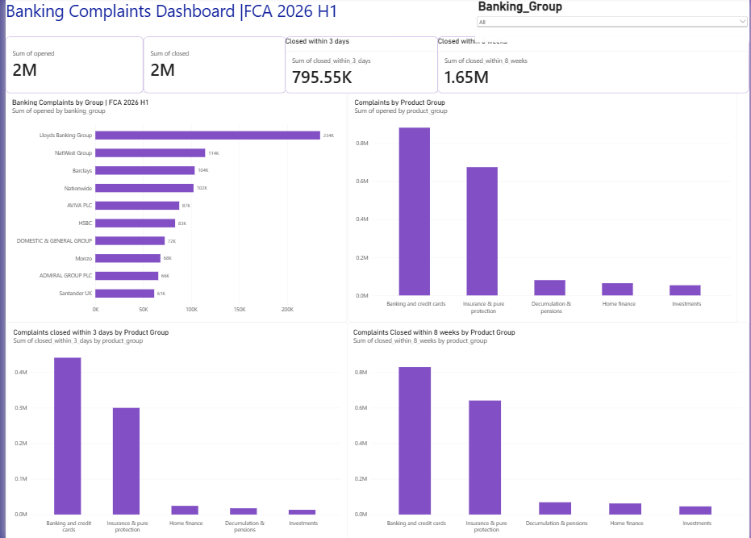
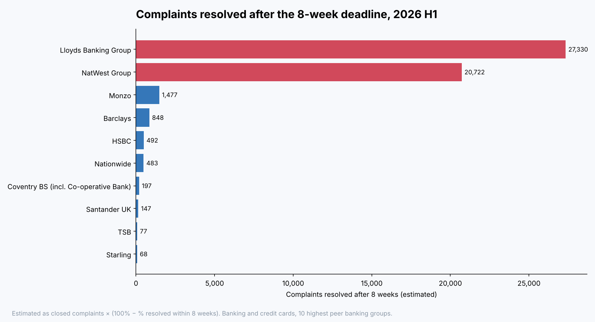

# UK Bank Complaints: Which Banks Are Getting It Wrong?

An analysis of FCA complaints data for 22 UK banking groups, including HSBC, Barclays, Lloyds, NatWest, Santander, Nationwide, Monzo and Starling. It compares how often customers complain, how often the bank agrees it was at fault, and how quickly complaints are resolved. These are the outcome measures behind the FCA's **Consumer Duty**.

**Tools:** SQL (SQLite) · Python (pandas, matplotlib) · Power BI (DAX, star schema)
**Data:** [FCA firm-level complaints data](https://www.fca.org.uk/data/complaints-data/firm-level), 2026 H1, covering firms with 500+ complaints in the half-year



## Interactive Power BI Dashboard


## Key findings: banking and credit cards, 2026 H1

**1. Lloyds and NatWest miss the 8-week deadline far more often than any other bank.**
Banks must give a final response within 8 weeks, or the customer can take the complaint to the Financial Ombudsman. Every other peer bank resolved at least 97.6% of complaints in time. **Lloyds Banking Group resolved 86.4% and NatWest Group 82.0%.** That is about **27,300 Lloyds and 20,700 NatWest complaints** resolved after the deadline in six months, roughly 1 in 7 and 1 in 5 respectively. Across all the other peer banks combined, the figure was under 4,000.

**2. Lloyds and NatWest are also the only big banks above the peer average on both complaint rate and % upheld.**

| Banking group | Complaints | Per 1,000 accounts | % upheld | % resolved in 8 weeks |
|---|---|---|---|---|
| Lloyds Banking Group | 202,389 | 2.77 | 65.2% | 86.4% |
| NatWest Group | 105,356 | 2.74 | 55.8% | 82.0% |
| Barclays | 95,471 | 2.34 | 56.9% | 99.1% |
| Nationwide* | 93,640 | 2.24 | 55.1% | 99.5% |
| HSBC | 77,159 | 2.20 | 59.3% | 99.3% |
| Monzo* | 67,488 | 2.39 | 24.0% | 97.9% |
| Santander UK | 57,274 | 2.36 | 46.9% | 99.7% |
| **Peer average** | | **2.42** | **54.5%** | |

Lloyds alone accounts for a quarter of all banking complaints across the 22 peer groups. Its rate per 1,000 accounts is the highest of the big five, and it agrees the customer was right in nearly two out of three cases.

**3. Digital banks uphold far fewer complaints.**
Digital banks upheld **30.0%** of complaints, against **58.4%** for high-street banks, and resolved more within 8 weeks (98.5% against 91.5%). Monzo upheld just 24.0%. A lower upheld rate can mean fewer genuine failures, or a firm that is slower to accept fault, and this data alone cannot tell which. That makes it a question worth raising rather than a conclusion.

**4. Smaller banks have the highest complaint rates.**
Zopa (3.78 per 1,000 accounts), Metro Bank (3.12), Starling* (3.09) and TSB (3.05) top the table, all above every big-five bank.

\*Nationwide, Monzo and Starling report on an October–March window. All other banks shown report January–June.



## How it works

```
FCA Excel files ──► Python (etl/load_fca.py) ──► SQLite staging ──► SQL star schema ──► Power BI
                     reshape 5 measure sheets      stg_complaints     fact + 3 dimensions    Power BI-ready data exports
```

1. **Extract and reshape.** The FCA publishes each measure (opened, closed, % upheld and so on) as a separate wide sheet with one column per product. `load_fca.py` reshapes every sheet to one row per firm and product, merges them, and converts the FCA's fractions to percentages.
2. **Model in SQL.** `02_build_model.sql` builds a star schema (`fact_complaints` with `dim_firm`, `dim_period` and `dim_product`). Firms are mapped to banking groups using the FCA's own group field plus a reference table (`data/reference/banking_groups.csv`). For example, Halifax and Bank of Scotland roll up to Lloyds Banking Group, and Co-operative Bank to Coventry Building Society.
3. **Correct aggregation.** The FCA gives percentages per firm. The model converts them back to counts (for example, upheld = closed × % upheld), so every total is a ratio of sums, never an average of percentages. Complaint rates use an *implied number of accounts* (complaints ÷ rate × 1,000), which lets the rate for a group of firms be calculated correctly.
4. **Analyse.** `04_analysis.sql` answers six questions using CTEs, window functions (`RANK`, `LAG`, `SUM() OVER`) and peer benchmarks.
5. **Visualise.** Power BI imports the star schema from `powerbi/data/`. The DAX measures are in `powerbi/dax_measures.md`.

## Data quality checks

| Check | Result |
|---|---|
| Product columns add up to the FCA Grand Total (opened and closed) | 0 mismatches |
| Duplicate period-firm-product keys | 0 |
| Percentages outside 0–100 | 0 |
| % within 3 days + % within 8 weeks > 100% | 0 |
| Negative counts | 0 |
| Reference mappings that matched no firm | 0 |
| Firm-product rows with no accounts figure (excluded from per-1,000 rates only) | 43 |
| Firms reporting on a non-calendar 6-month window | 34 of 226 |

## Power BI report

| Page | What it shows |
|---|---|
| **Overview** | Headline KPIs, complaint rate by banking group against the peer average, and bank segment comparisons |
| **Bank comparison** | Select a bank to compare it with peers by product, with % upheld over time |
| **Consumer Duty view** | Scatter of complaint rate against % upheld with peer-average quadrants, a bank × product heatmap, and the biggest increases |

Includes 20 DAX measures: period-on-period change, peer averages that ignore the bank filter, dynamic ranking, a dynamic page title and conditional colour.

The charts in this README are static previews generated by `create_dashboard.py` from the SQL results. The interactive report is built in Power BI Desktop from `powerbi/data/`, using `powerbi/dax_measures.md` and the page-by-page guide in `powerbi/report_layout.md`.

## Repository structure

```
├── etl/load_fca.py               # Extract, reshape, load, run SQL, export for Power BI
├── create_dashboard.py           # Static chart previews for this README
├── sql/
│   ├── 01_schema.sql             # Staging, reference and star-schema tables
│   ├── 02_build_model.sql        # Builds dimensions and fact from staging
│   ├── 03_quality_checks.sql     # 10 data quality checks
│   └── 04_analysis.sql           # 6 analysis questions
├── data/
│   ├── raw/                      # FCA Excel files
│   └── reference/banking_groups.csv
├── powerbi/
│   ├── data/                     # Star-schema CSVs imported by Power BI
│   ├── dax_measures.md
│   ├── report_layout.md
│   └── theme.json
├── results/                      # Quality check and analysis outputs
└── images/                       # Chart previews
```

## How to run

```bash
pip install -r requirements.txt
python etl/load_fca.py
python create_dashboard.py
```

To add a new half-year, download the FCA's `firm-level-complaints-data-YYYY-hN.xlsx` into `data/raw/` and run the script again. Every period is reloaded and the Power BI tables are refreshed.

## Limitations

- **Self-reported data.** Firms report their own complaint numbers and account counts to the FCA, which publishes them as submitted.
- **Different reporting windows.** Some firms, including Nationwide, Monzo and Starling, report on a 6-month window that does not match the calendar half-year.
- **Size threshold.** Only firms with 500 or more complaints in the period are published individually.
- **% upheld is the firm's own decision.** It does not include later Financial Ombudsman rulings.
- **Comparing products.** Complaint rates are only comparable within one product group, because rates per account and rates per policy measure different things. The report defaults to banking and credit cards.
- **Groups follow current ownership.** Firms are grouped by the FCA's group field for the latest period.
